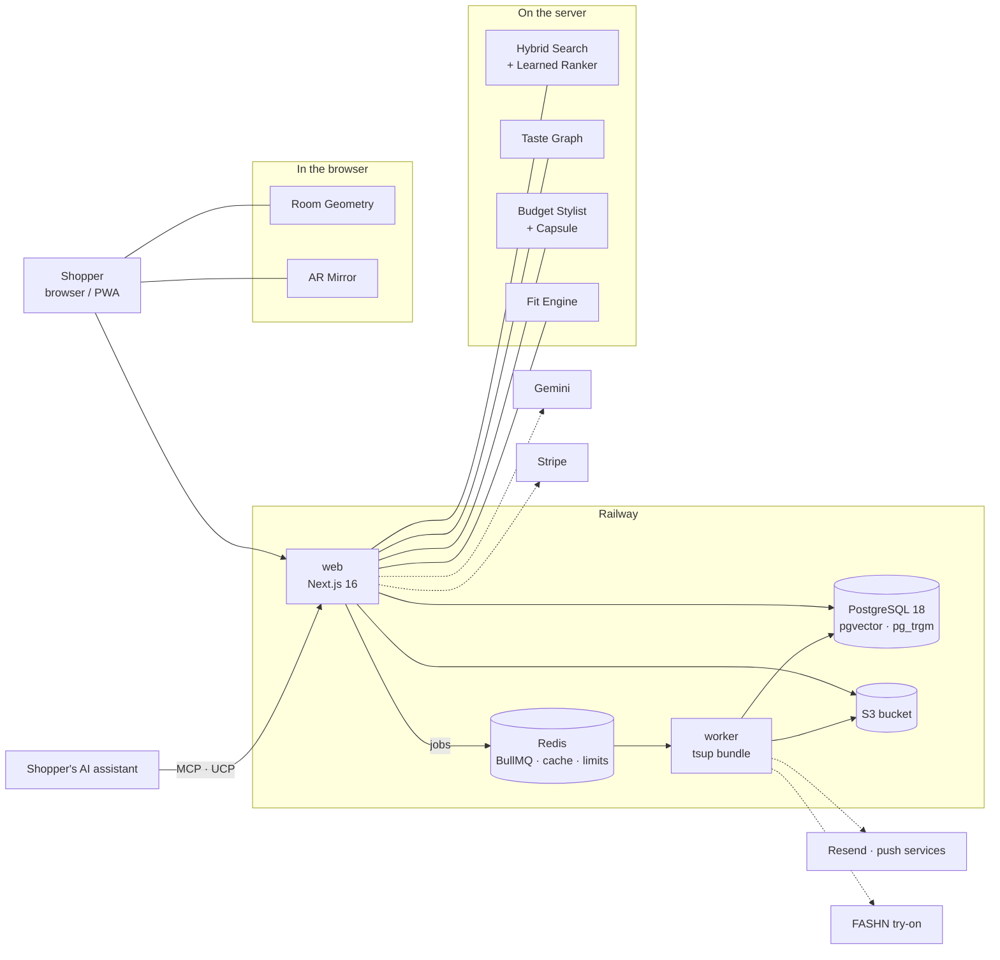

<div align="center">

# 🪟 Vitrine

### An AI-native e-shop you can browse, type to, talk to, show a photo — or hand to your own AI assistant.

*βιτρίνα (vi-TREE-na): Greek for "shop window"*

<br>


**ITC 4879 Capstone Project** · George Papasotiriou · [g.papasotiriou@acg.edu](mailto:g.papasotiriou@acg.edu)

**[Live demo](https://itc-4879-capstone-vitrine-production.up.railway.app)** · payments in test mode, nothing is shipped

</div>

---

## ✨ What is Vitrine?

Most online shops feel like spreadsheets: endless grids of identical cards.
**Vitrine is designed to feel like a shop window at dusk.** The interface stays quiet, products
stand on plinths at their true size, and light shows where the AI is acting.

**3,606 products:** 3,170 pieces of furniture and home goods, and 436 things to wear (clothes, shoes, bags and accessories).
You can shop the ordinary way, or:

- **type or talk** to the Concierge (*Σύμβουλος*), which searches, compares, fills your cart and drives the page while you watch;
- **show a photo**, and find pieces in the colours you like, or the whole look in it;
- **place a sofa in a photo of your room** at its real size, in your room's own light;
- **try on hats, earrings and necklaces live** in the AR Mirror, with your own camera;
- **find your size** from how a garment really fits, and **build a capsule wardrobe** within a budget;
- **let your own AI assistant shop for you** over MCP, with a key you control.

Underneath is a real commerce engine (cart, EU VAT, Stripe, orders, returns, a support desk) and
**seven algorithms built from scratch**, each with its own maths, tests and measured evaluation.

---

## 🧠 The seven algorithms

<table>
<tr>
<td width="50%" valign="top">

### 🔎 Hybrid Search
Understands `μαύρη δερμάτινη πολυθρόνα κάτω από 300€` (black leather armchair under €300),
typos like `chiar`, and **Greeklish** such as `kanapes`.

Parse → lexical (words weighted by rarity) + fuzzy retrieval → **Reciprocal Rank Fusion** →
Bayesian re-ranking → **Maximal Marginal Relevance**.

📊 NDCG@10 on 500 Amazon ESCI queries: lexical **0.458** → fusion **0.544** → with rarity weights **0.567**.

</td>
<td width="50%" valign="top">

### 📈 Learned Ranker
**LambdaMART written from scratch** in NumPy: lambda gradients of NDCG, histogram regression
trees, Newton leaf values, early stopping. 20 features computed by the shop; the trained trees
run inside the shop.

📊 Fusion **0.567 → 0.626** NDCG@10 on the same 500 queries (offline: +0.060, 95% interval
+0.048 to +0.070), for about 2 ms per search.

</td>
</tr>
<tr>
<td width="50%" valign="top">

### 🕸️ Taste Graph
A recommender that learns from behaviour **only with consent**.

Session co-occurrence edges with time decay, content vectors, **Personalized PageRank**
(random walk with restart) and a *This-or-That* game that learns a new shopper's taste from a
few choices. Powers "Complete the set" and the shelves.

📊 On the OTTO dataset (20,000 test sessions): **0.532** weighted Recall@20, close to a
co-visitation baseline (0.537).

</td>
<td width="50%" valign="top">

### 💶 Budget Stylist & Capsule Wardrobe
*"A reading corner for €1,500, nothing orange."*

A constrained optimiser that picks the best set of pieces under a budget, scoring how well they
go together with style similarity and **colour harmony in CIELAB/LCh**. Its second half builds
**capsule wardrobes**: the most good outfits for the money (greedy start, single and double swaps,
restarts).

📊 **Zero optimality gap** on 197 instances, 4 ms at p95 · capsules exact on **70/70**,
7.3 outfits against 4.8 for greedy.

</td>
</tr>
<tr>
<td width="50%" valign="top">

### 📐 See It In Your Room
A sofa in a photo of your room **at true scale**, with no LiDAR.

- **With a sheet of A4:** sub-pixel corners, a **homography (DLT)**, camera pose, focal length from EXIF.
- **Without paper:** **Depth Anything V2 (metric)** runs *in your browser* (ONNX Runtime Web) and gives distances in metres; a **RANSAC** fit with a gravity prior finds the floor.
- **In your light:** a white-patch estimate relights the product photo in linear light and casts its shadow.

📊 **2.2%** size error with the sheet on real rooms (1.3% synthetic) · light matching cuts the
colour difference from **8.2 to 4.7 ΔE2000** on held-out rooms.

</td>
<td width="50%" valign="top">

### 👗 Fit Engine
"Find your size" from how garments really fit.

An **ordinal probit model** in which each item has its own size offset **and its own
tolerance**, learned by assumed-density filtering with expectation-propagation messages. It reads
reviewers' fit remarks first, then the shop's own too-small / too-big returns.

📊 AUC **0.716** on RentTheRunway and **0.694** on ModCloth; the per-item tolerance adds
+0.026 / +0.039.

</td>
</tr>
<tr>
<td width="50%" valign="top">

### 🪞 AR Mirror
Hats, earrings and necklaces on your own face, live, on your own device.

The head's pose solved from 468 face landmarks by the shop's own solver (weak-perspective start,
**Levenberg–Marquardt** with an analytic Jacobian, Huber weights), true size from the irises,
**One-Euro** smoothing, a damped pendulum for earrings, light read from the whites of the eyes.

📊 Head-pose error on AFLW2000-3D (1,399 faces): **3.18°**, against 3.31° for MediaPipe's own.

</td>
<td width="50%" valign="top">

### 🧩 Smaller home-made pieces

- **"Will it get in?"** Doorways, corridors and the moving-sofa bound, checked against brute force.
- **Colour season:** a colour reading corrected for the room's light.
  - 📊 The same season under a warm lamp 85.9% of the time, against 52.1% uncorrected.
- **A parametric 3D modeller** for every one of the 1,950 placeable pieces, at its listed size.
- **Review summaries** in English and Greek, with every point linked to the sentences behind it.
- **A k-means colour reader** for search by photo.
- **CIEDE2000**, implemented from the paper.

</td>
</tr>
</table>

---

## 🛍️ Features

| | |
|---|---|
| 🌍 **Truly bilingual** | English and Greek as equal storefronts: hand-written Greek, `hreflang`, localised URLs |
| 🤖 **AI Concierge** | Chat or voice, **39 typed tools**, approval cards for anything that matters, undo for every action, a cost guard with per-user credits, a daily budget and a kill switch. Opens from the header, the bottom bar on phones, or a bubble on wide screens |
| 🎙️ **Voice** | Speak in Chrome or Edge with no key; live voice with OpenAI or Google realtime models when configured; captions always on |
| 🪑 **3,606 products** | Furniture and home goods with real 3D scans and 360° spins (Amazon Berkeley Objects); 436 things to wear with real photographs and real customer reviews shown apart from the shop's own |
| 🧭 **Easy to find your way** | A categories menu beside the logo, instant search (`/`), filters by size, kind and wearer |
| 🧊 **3D and AR** | A 3D model for every placeable piece at its true size, "Show size" in cm, AR through WebXR, Scene Viewer and Quick Look |
| 🪞 **AR Mirror & Fitting Room** | Live try-on of hats, earrings and necklaces; virtual try-on of clothes with consent (switched on with a FASHN key). Photos expire after 24 hours and can be deleted at once |
| 📏 **Fit & style** | "Find your size", "Complete the look", capsule wardrobes within a budget, your colour season |
| 📷 **Search by photo** | Colours read from your photo; "Shop the look" finds each piece in a photo |
| 🛋️ **Room boards** | Plan a room with someone else, live, with presence |
| 🪟 **Showcase mode** | A lit 3D room of real scans, composed by the Budget Stylist |
| 🔌 **Agent-ready** | An **MCP** server (spec 2026-07-28, plus older `initialize` clients), personal agent keys, **UCP** checkout sessions that always hand the buyer back to the shop, **WebMCP** tools for assistants built into the browser |
| 🧾 **EU VAT done right** | Prices for your country; VAT by the **delivery address** (One-Stop Shop), delivery to 10 countries beyond the EU |
| 💳 **Payments** | Stripe in test mode: Payment Element, Apple Pay and Google Pay, signed idempotent webhooks, refunds. Without keys, a local test payment |
| 👤 **Accounts** | Email and password, Google sign-in, passkeys, TOTP two-step codes, four roles; guest carts merged on sign-in; quick navigation on the account page |
| 🔔 **Notifications** | Web Push written from RFC 8291/8292 with no dependency: order updates, watched prices, desk replies — opt-in only |
| 🛠️ **Running the shop** | Order desk, product editor with AI copy drafts, review moderation, support desk with a reply clock, dashboards, AI spend, an audit log, a weekly PDF report |
| 🔒 **Privacy by design** | IP looked up in a **local** country database; personalisation opt-in; every stored line about you listed at `/account/data`, deletable and downloadable |
| 🛡️ **Security** | Nonce-based Content Security Policy on every page, HSTS, Permissions-Policy, shared rate limits in Redis; the model never owns money or truth |
| ♿ **Accessible** | WCAG 2.2 AA, full keyboard support, a reading-comfort panel (text size, contrast, readable font, motion), point by number, `prefers-reduced-motion` |
| 📱 **Installable PWA** | Hand-written service worker; network-first, so prices are never stale |

---

## 🏗️ Architecture



- **One tool registry.** Every AI capability is one typed tool. Chat, voice, MCP, WebMCP and UCP are thin adapters over it, with the same authorisation.
- **One database as the source of truth.** Relational data, full-text, fuzzy and vector search all live in PostgreSQL; prices and totals always come from it, never from a model.
- **Web and worker from one repository.** The worker is bundled into a single file, so there are no module-resolution surprises at runtime.
- **Your room photo and your face stay on your device.** Room geometry, depth estimation and the AR Mirror run in the browser.

---

## 🧰 Tech Stack

| Layer | Technology |
|---|---|
| **Frontend** | Next.js 16 (App Router, Turbopack), React 19.2, Tailwind CSS v4, Radix UI, Motion, next-intl |
| **3D / vision** | model-viewer, three.js, glTF-Transform, ONNX Runtime Web (Depth Anything V2), MediaPipe Face Landmarker |
| **Backend** | Route handlers, Zod at every boundary, Pino structured logs |
| **Data** | PostgreSQL 18, pgvector, pg_trgm, unaccent, Drizzle ORM |
| **Jobs & cache** | Redis + BullMQ, worker bundled with tsup |
| **AI** | AI SDK 7 with Gemini; OpenAI or Google realtime for live voice; FASHN for try-on |
| **Auth & payments** | Better Auth (passkeys, TOTP, Google), Stripe (test mode) |
| **Email & push** | Resend, Web Push (RFC 8291/8292) |
| **Research** | Python (NumPy, Polars, pytest) for the offline evaluations and the ranker's training |
| **Quality** | Vitest, Playwright + axe-core, Lighthouse, k6, ESLint, TypeScript strict |
| **Hosting** | Railway |

---

## 🚀 Getting Started

**Requirements:** Node.js 24 and pnpm. No Docker, no API keys.

```bash
git clone https://github.com/George0Papasotiriou/ITC-4879-Capstone-Vitrine.git
```

```bash
cd ITC-4879-Capstone-Vitrine && pnpm install
```

```bash
pnpm local
```

`pnpm local` starts an embedded PostgreSQL with pgvector, seeds a sample catalogue on first
start, and opens the shop at **http://localhost:3000**.

With no keys at all:

- the Concierge answers from rules (demo mode), with the same tools, approvals and undo;
- emails arrive at `/en/lab/outbox`;
- payment is a local test payment.

Each key in [`.env.example`](.env.example) switches on the real service.

### Useful commands

| Command | What it does |
|---|---|
| `pnpm local` | Database + dev server |
| `pnpm build` | Production build (web + worker) |
| `pnpm test` | Unit tests |
| `pnpm test:integration` | Integration tests against a real PostgreSQL |
| `pnpm test:e2e` | Playwright end-to-end tests (desktop + mobile, accessibility, security policy) |
| `pnpm evals:full` | Concierge golden and adversarial tasks (needs a running shop) |
| `pnpm evals:esci` · `evals:search` | Hybrid search and the learned ranker on Amazon ESCI queries |
| `pnpm evals:stylist` · `evals:capsule` | Budget Stylist and capsule wardrobes against exhaustive search |
| `pnpm evals:room` · `evals:room-rendered` · `evals:room-harmonize` | Room geometry, depth and light matching |
| `pnpm evals:mirror` · `evals:colours` | AR Mirror head pose and colour season |
| `pnpm evals:models` · `models:check` | 3D models against real scans, and file validation |
| `pnpm reco simulate` | Synthetic shopper sessions for the Taste Graph |
| `pnpm push keys` | Make the VAPID key pair for notifications |
| `pnpm demo:reset` | A fresh local shop (the old database is set aside, never deleted) |

---

## 🔌 Connect your own AI assistant

Any MCP client can search the shop, with no key needed:

```json
{
  "mcpServers": {
    "vitrine": { "type": "http", "url": "https://<your-app>/api/mcp" }
  }
}
```

To let the assistant use **your** cart and orders, make a key at `/account/agents`, choose what it
may do and for how long, and add `"headers": { "Authorization": "Bearer vta_…" }`. Keys are stored
only as a fingerprint and can be revoked at any time.

Checkout always ends on the shop's own page, where you pay yourself. Shopping agents can discover
the shop at `/.well-known/ucp`.

---

## ☁️ Deploying to Railway

Vitrine runs as **two services from this one repository**, plus PostgreSQL (pgvector template),
Redis and a Bucket:

| Service | Build | Start |
|---|---|---|
| `web` | `pnpm build` | `pnpm start:app`, with `pnpm db:setup` as the pre-deploy command |
| `worker` | `pnpm build` | `pnpm worker:start` |

`pnpm db:setup` applies the migrations and syncs the full catalogue on every deploy. The health
check is `/api/health`.

**Required:** `APP_URL`, `DATABASE_URL`, `REDIS_URL`, `COOKIE_SECRET`, `BETTER_AUTH_SECRET` and
the bucket's S3 variables.

**Optional:** each turns on one feature when set, and the shop works without it.

| Variables | Feature |
|---|---|
| `AI_PROVIDER`, `GOOGLE_GENERATIVE_AI_API_KEY` | Gemini |
| `AI_DAILY_BUDGET_EUR`, `AI_KILL_SWITCH` | The AI cost guard |
| `VOICE_PROVIDER`, `OPENAI_API_KEY` | Live voice |
| `STRIPE_*` | Stripe payments (test keys only) |
| `RESEND_API_KEY`, `EMAIL_FROM` | Email |
| `VAPID_*` | Push notifications |
| `FASHN_API_KEY` | Virtual try-on |
| `PICTURES_PROVIDER` | AI pictures of a piece in a room |
| `SEARCH_RANKER` | The learned ranker (on / off) |
| `GOOGLE_CLIENT_*` | Google sign-in |
| `SHOWCASE_PASSWORD` | Demo accounts for reviewers, two per role |

The full list is in [`.env.example`](.env.example).

---

## 🧪 Testing

```
✔ 1,710 unit tests         pure logic, all seven algorithms, protocols, crypto
✔   276 integration tests  real PostgreSQL with pgvector
✔   568 end-to-end tests   desktop + mobile, accessibility checks, security policy enforced
✔    52 Python tests       the offline evaluations, with parity checks against the shop's code
✔ 50/50 Concierge tasks    in demo mode (6 more need a live model), plus 17/17 adversarial
                           (prompt injection, other people's data, paying without asking)
```

Lighthouse on the live site, mobile: accessibility, best practices and SEO **100**; performance
**76–89** depending on the page.

The algorithms are measured, not just tested:

| | What was measured | Result |
|---|---|---|
| Search | 500 Amazon ESCI queries with human labels | NDCG@10 0.567 → 0.626 with the learned ranker |
| Taste Graph | OTTO dataset, 20,000 test sessions | 0.532 against co-visitation's 0.537 |
| Budget Stylist | Against exhaustive search, 197 instances | Optimal on every one |
| Capsule wardrobe | Against exhaustive search, 70 instances | Optimal on 70/70 |
| Room geometry | Real rooms with an A4 sheet | 2.2% size error |
| Fit Engine | RentTheRunway and ModCloth | AUC 0.716 and 0.694 |
| AR Mirror | AFLW2000-3D, 1,399 faces | 3.18° head-pose error |
| 3D models | Against 205 real scans | Shape overlap 0.407 → 0.498 |

---

## 📁 Project Structure

```
src/
├── app/              pages (storefront, account, staff, admin) and API routes
├── components/       commerce, concierge, room, display, shell, staff, ui
├── lib/
│   ├── search/       🔎 hybrid search and the learned ranker
│   ├── reco/         🕸️ Taste Graph
│   ├── optimize/     💶 Budget Stylist, outfits and capsule wardrobes
│   ├── fit/          👗 Fit Engine and "will it get in"
│   ├── vision/       📐 room geometry, depth, light, colour, 🪞 AR Mirror
│   ├── catalog/      catalogue, menu and the parametric 3D modeller
│   ├── ai/           tool registry, prompts, providers, MCP / WebMCP / UCP adapters
│   ├── commerce/     cart, pricing, VAT, order state machine
│   ├── payments/     Stripe
│   ├── push/         Web Push (RFC 8291/8292)
│   ├── security/     security headers and CSP
│   ├── kv/           Redis: limits, cache, trending, live updates
│   └── db/           schema and client
└── worker/           background jobs
research/             Python offline evaluations (OTTO, ranker, fit)
scripts/              local stack, imports, evaluations
evals/                Concierge golden and adversarial tasks
tests/                integration and end-to-end suites
drizzle/              database migrations
```

---

## 🗺️ Roadmap

- [x] Design system and bilingual storefront
- [x] Catalogue with 3D scans, hybrid search, Taste Graph, Budget Stylist
- [x] Cart, checkout, EU VAT and exports, orders and returns
- [x] Room placement, with paper and without, plus light matching
- [x] Accounts (passkeys, two-step codes, Google sign-in, roles)
- [x] AI Concierge (chat and voice), search by photo, Shop the look
- [x] Staff desk, dashboards, support desk, weekly report
- [x] Stripe payments (test mode), Redis store, Showcase mode, review summaries
- [x] Agent-ready shop (MCP, WebMCP, UCP) and Web Push
- [x] Security hardening (nonce CSP, HSTS)
- [x] Learned ranker for search
- [x] 3D models for every placeable piece
- [x] Real clothes, shoes, bags and accessories with real reviews
- [x] Fit Engine, AR Mirror, outfits, capsule wardrobes and colour season
- [x] Taste Graph evaluation on the OTTO dataset
- [X] Virtual try-on with a live FASHN key
- [ ] User study with real shoppers (future work)

---

## 🙏 Credits

- Furniture and home data, photography and 3D models: [Amazon Berkeley Objects](https://amazon-berkeley-objects.s3.amazonaws.com/index.html) (Collins et al., CVPR 2022), **CC BY 4.0**
- Clothing listings, photographs and customer reviews: [Amazon Reviews 2023](https://amazon-reviews-2023.github.io/) (Hou et al. 2024, McAuley Lab, UC San Diego), a public research dataset; no licence is stated
- Depth estimation: [Depth Anything V2 Metric (indoor, small)](https://huggingface.co/depth-anything/Depth-Anything-V2-Metric-Indoor-Small-hf), **Apache-2.0**
- Face landmarks: MediaPipe Face Landmarker (Google), **Apache-2.0**
- Evaluation data: Amazon ESCI (Reddy et al. 2022), OTTO (Kaggle, CC BY 4.0), RentTheRunway and ModCloth (Misra et al. 2018), AFLW2000-3D (Zhu et al. 2016)
- IP-to-country data: [DB-IP](https://db-ip.com), **CC BY 4.0**
- Typeface: Commissioner by Kostas Bartsokas, **SIL Open Font License**

> ⚠️ **Vitrine is an academic project, not a real shop.** Prices and stock are synthetic; payments
> run in test mode and nothing is ever shipped.

---

<div align="center">

**© 2026 George Papasotiriou. All rights reserved.**

ITC 4879 Capstone Project

</div>
